# 我的：整页照 Fluent 2 / Azure 重做框架（2026-11-07）

## 1. 手机端

### 1.1 我的求职

| 改之前 | 改之后 |
|---|---|
|  | 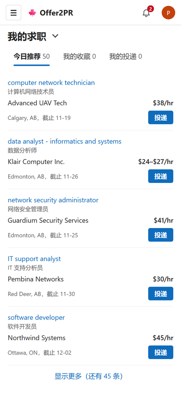 |

### 1.2 切换页签

| 改之前 | 改之后 |
|---|---|
|  | 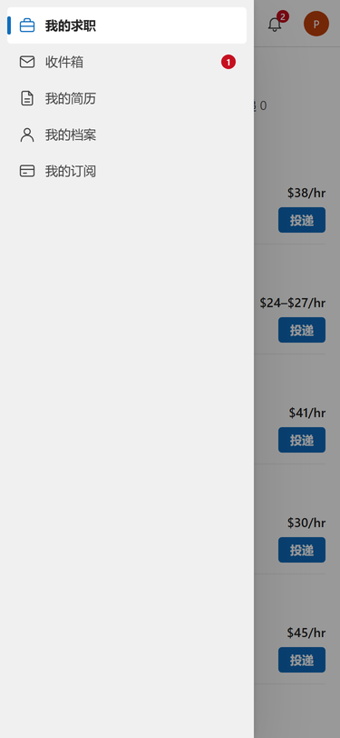 |

### 1.3 收件箱

| 改之前 | 改之后 |
|---|---|
|  |  |

### 1.4 我的简历

| 改之前 | 改之后 |
|---|---|
|  | 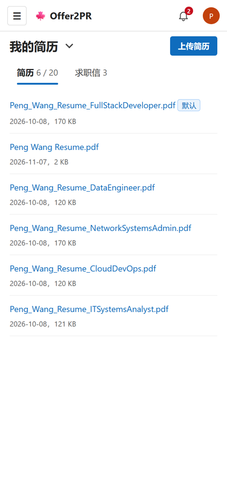 |

### 1.5 我的档案

| 改之前 | 改之后 |
|---|---|
|  | 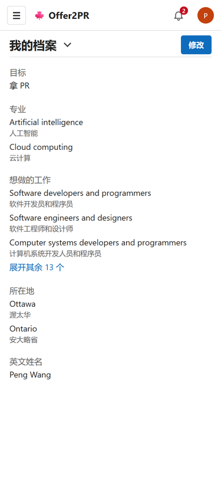 |

### 1.6 我的订阅

| 改之前 | 改之后 |
|---|---|
|  | 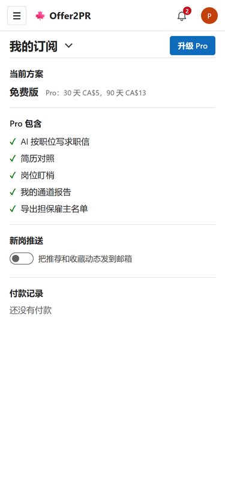 |

### 1.7 通知

| 改之前 | 改之后 |
|---|---|
|  | 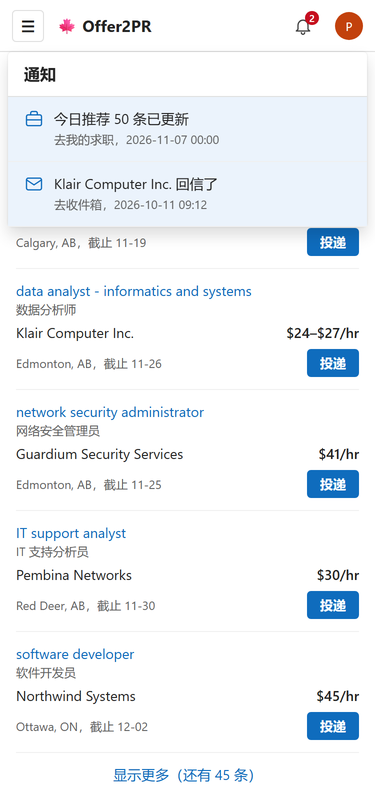 |

## 2. 网页端

### 2.1 我的求职

| 改之前 | 改之后 |
|---|---|
| 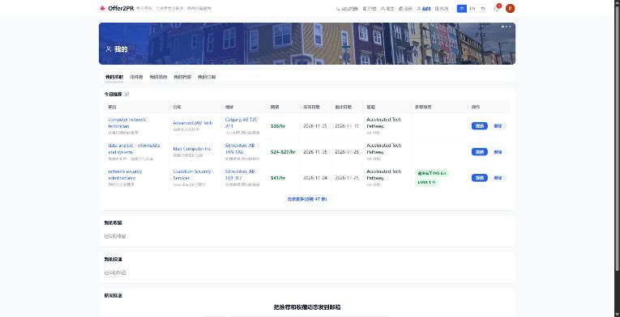 | 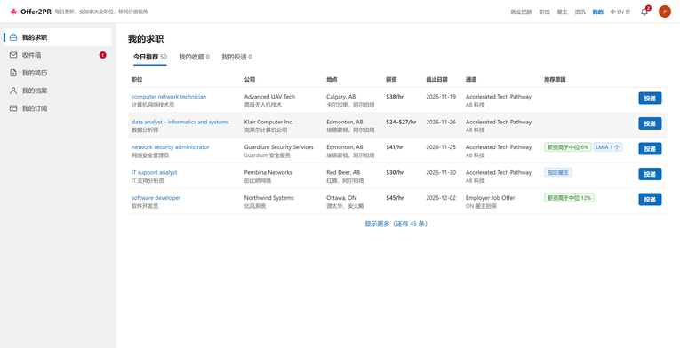 |

### 2.2 收件箱

| 改之前 | 改之后 |
|---|---|
| 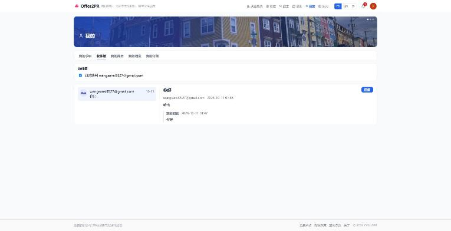 | 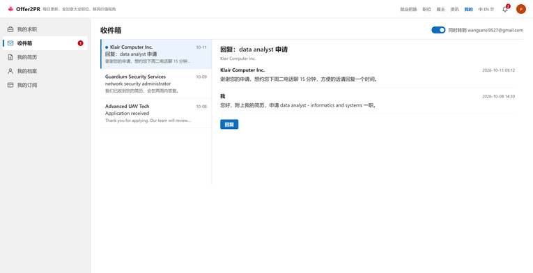 |

### 2.3 我的简历

| 改之前 | 改之后 |
|---|---|
| 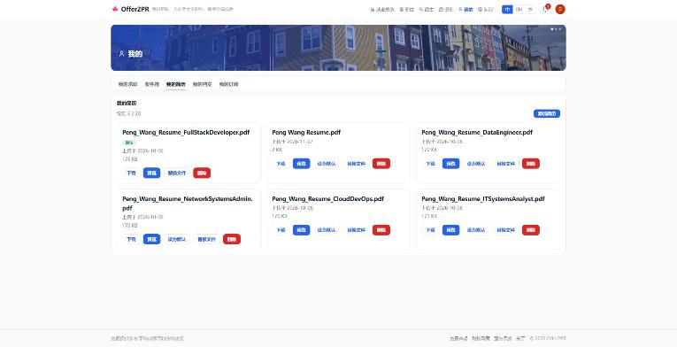 | 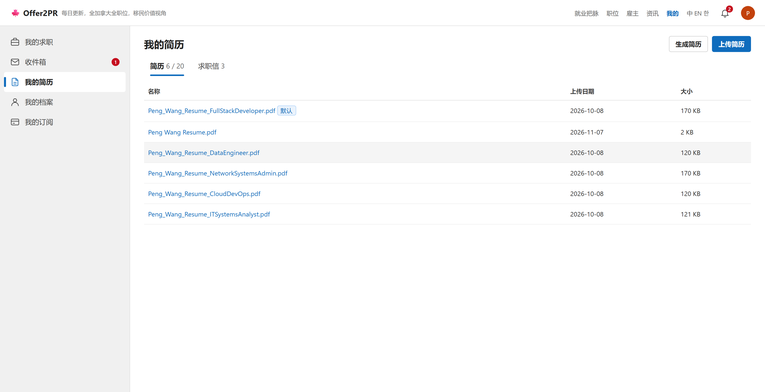 |

### 2.4 我的档案

| 改之前 | 改之后 |
|---|---|
| 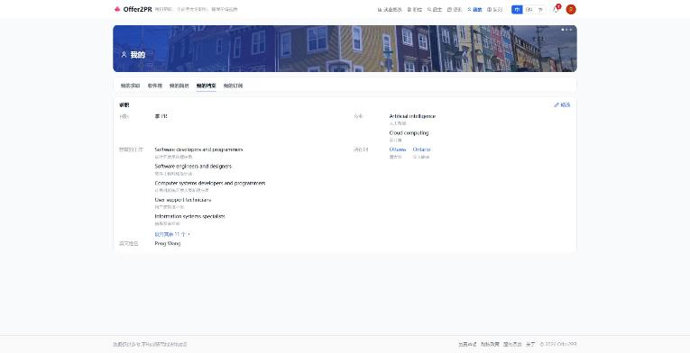 | 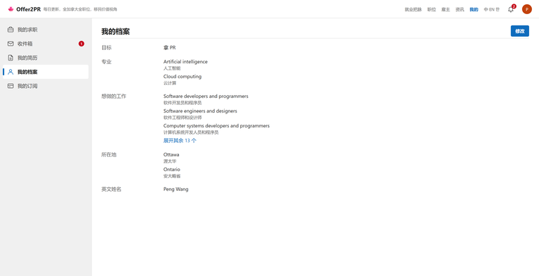 |

### 2.5 我的订阅

| 改之前 | 改之后 |
|---|---|
| 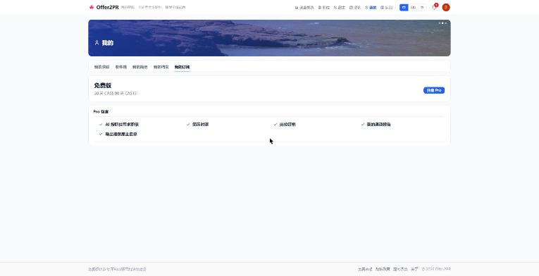 | 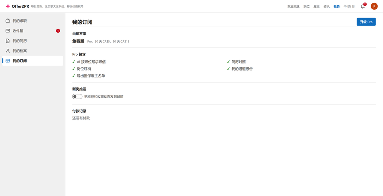 |

### 2.6 通知

| 改之前 | 改之后 |
|---|---|
| 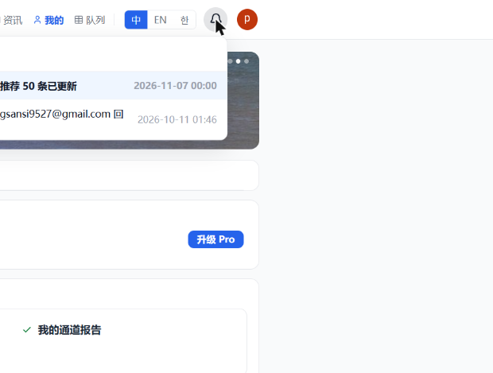 | 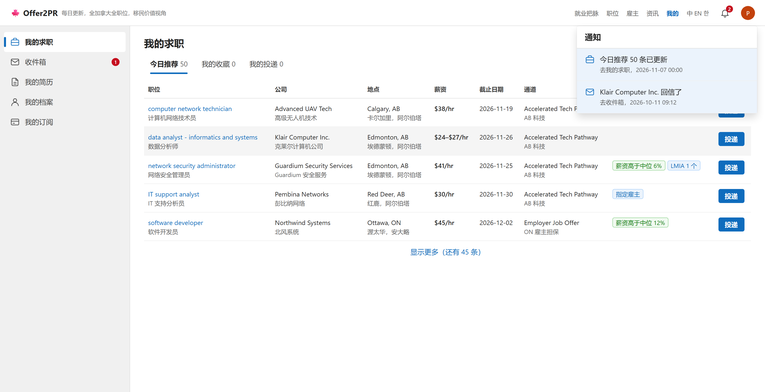 |
