# 我的简历

## 1. 手机端

### 1.1 简历卡片

| 改之前 | 改之后 |
|---|---|
| 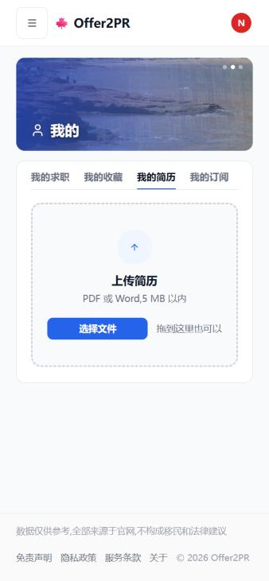 | 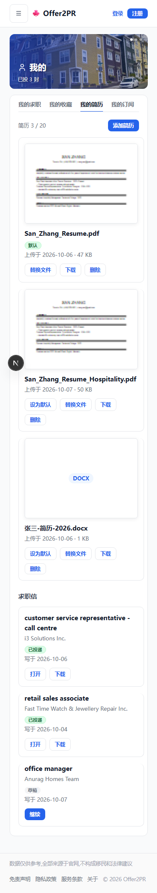 |

### 1.2 生成简历入口：我的简历页

| 改之前 | 改之后 |
|---|---|
|  |  |

### 1.3 生成简历入口：投递第 1 步

| 改之前 | 改之后 |
|---|---|
|  | 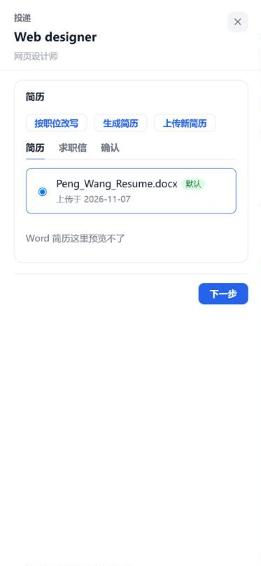 |

### 1.4 生成简历

| 改之前 | 改之后 |
|---|---|
| 无 | 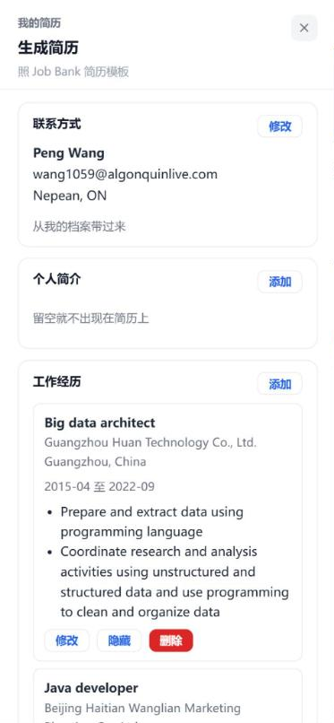 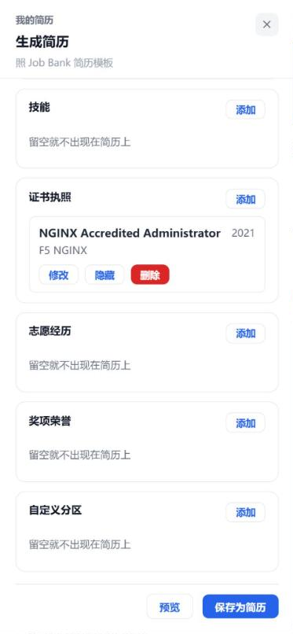 |

### 1.5 添加工作经历（导入 NOC 职责）

| 改之前 | 改之后 |
|---|---|
| 无 | 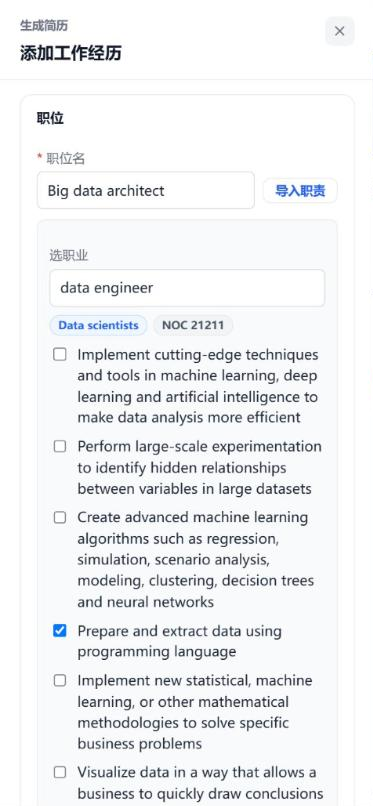 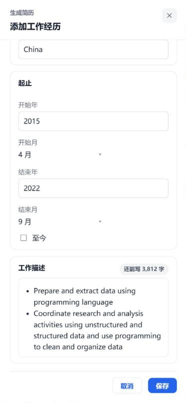 |

### 1.6 预览

| 改之前 | 改之后 |
|---|---|
| 无 |  |

## 2. 网页端

### 2.1 简历卡片

| 改之前 | 改之后 |
|---|---|
|  | 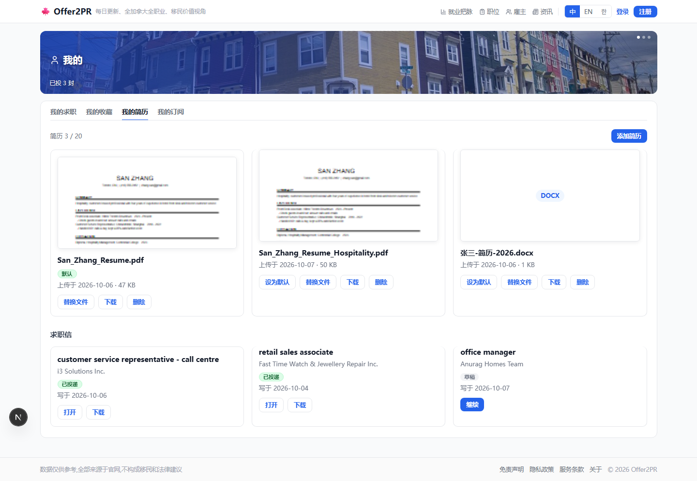 |

### 2.2 生成简历入口：我的简历页

| 改之前 | 改之后 |
|---|---|
| 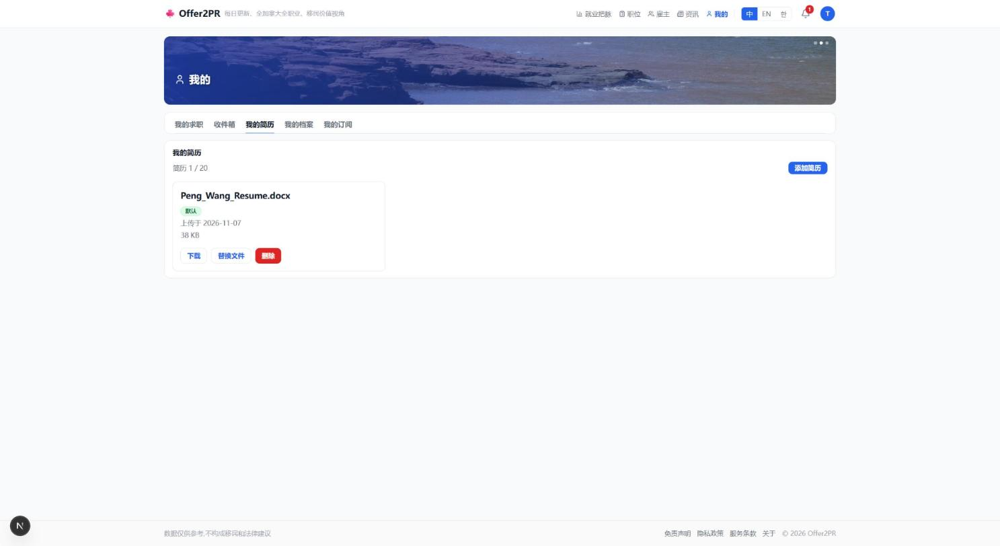 | 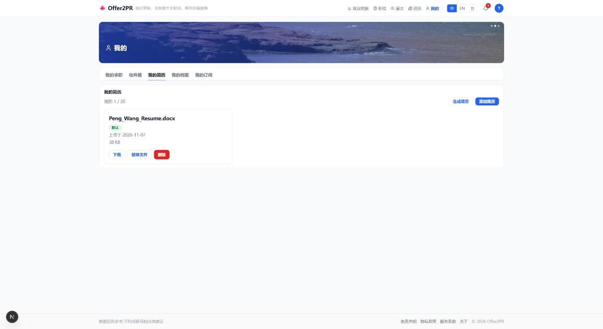 |

### 2.3 生成简历入口：投递第 1 步

| 改之前 | 改之后 |
|---|---|
| 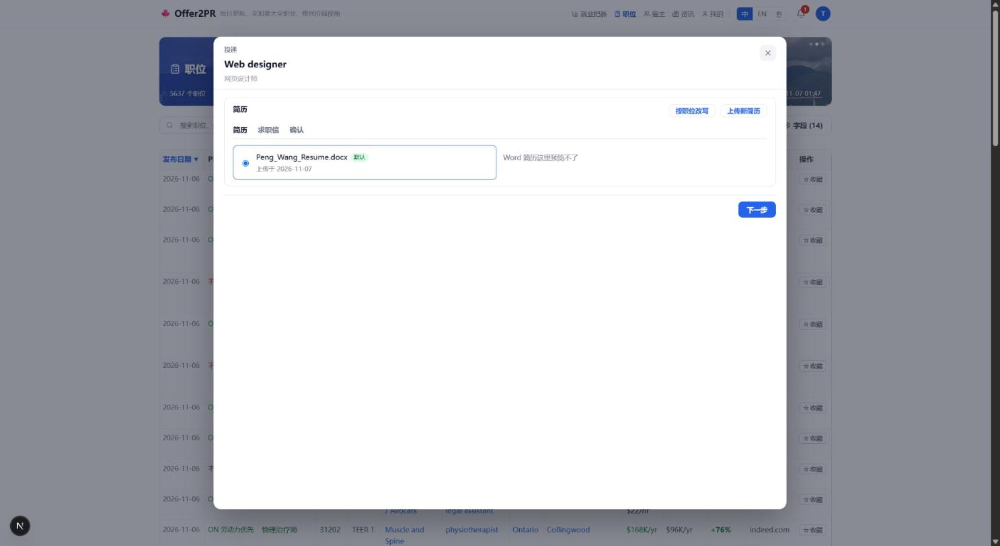 | 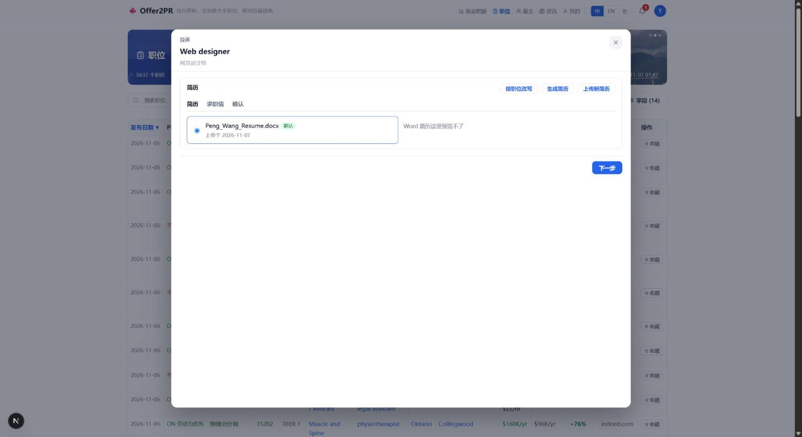 |

### 2.4 生成简历

| 改之前 | 改之后 |
|---|---|
| 无 | 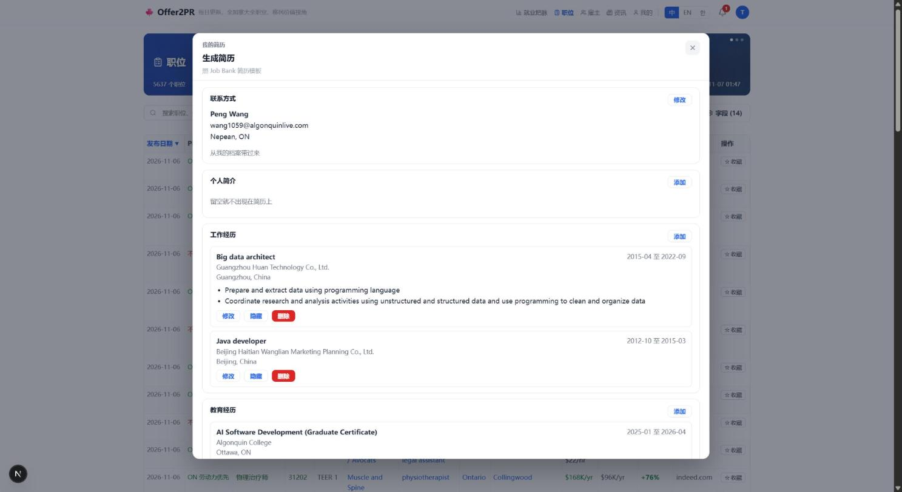 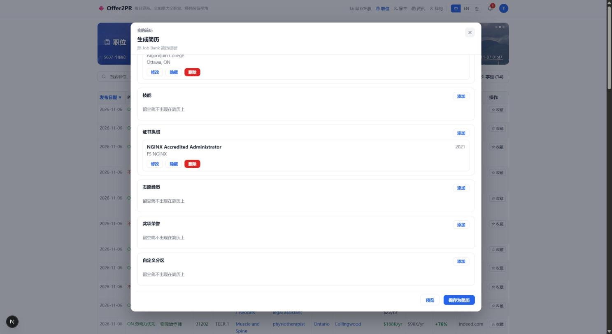 |

### 2.5 添加工作经历（导入 NOC 职责）

| 改之前 | 改之后 |
|---|---|
| 无 | 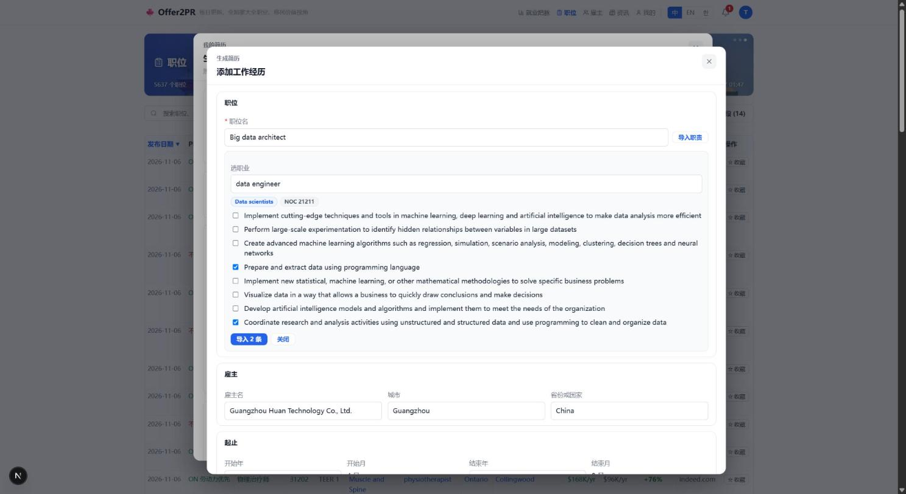 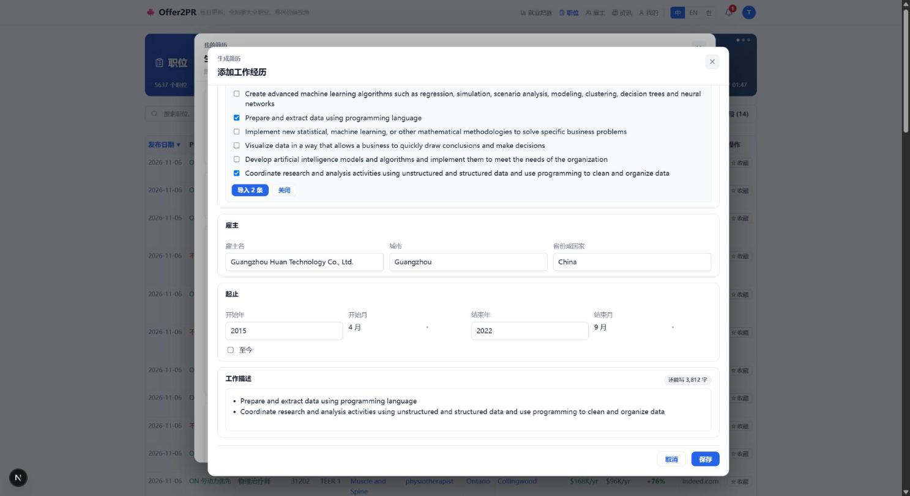 |

### 2.6 预览

| 改之前 | 改之后 |
|---|---|
| 无 | 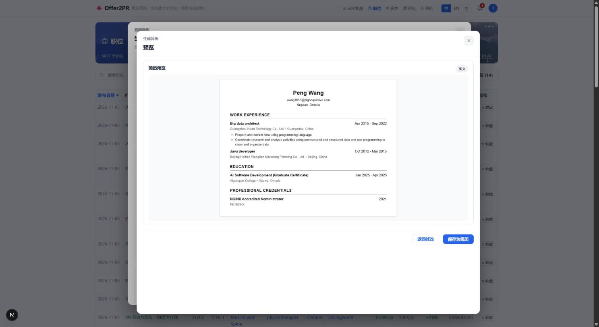 |
