# 我的订阅

## 1. 手机端

### 1.1 方案卡

| 改之前 | 改之后 |
|---|---|
| 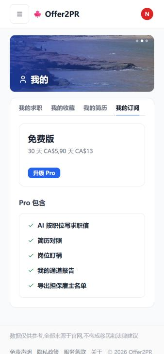 | 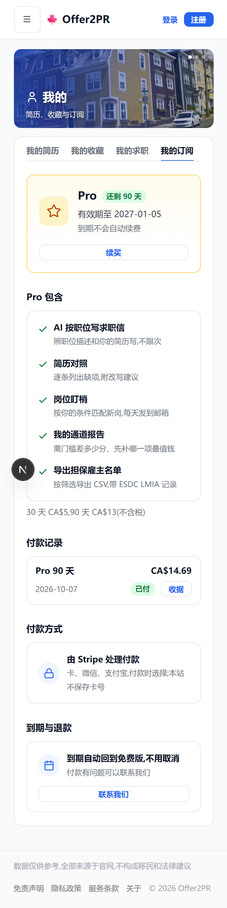 |

### 1.2 提醒列表:按档案推荐加按条件的提醒

| 改之前 | 改之后 |
|---|---|
| 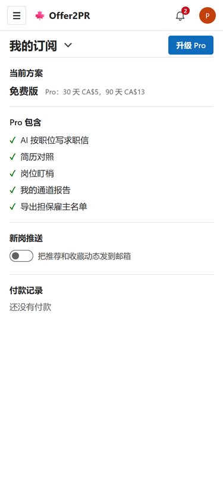 | 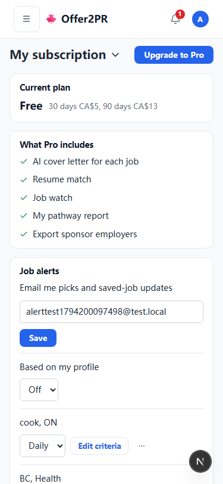 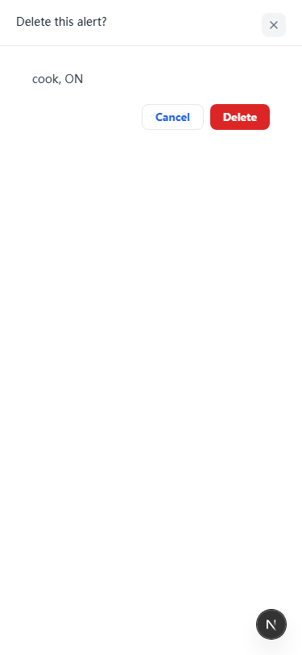 |

### 1.3 职位板创建提醒、改条件

| 改之前 | 改之后 |
|---|---|
|  | 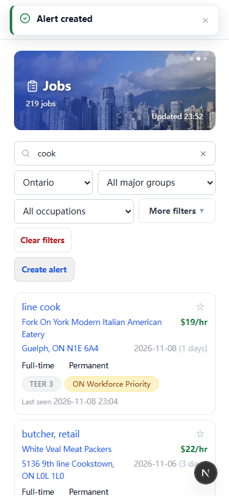 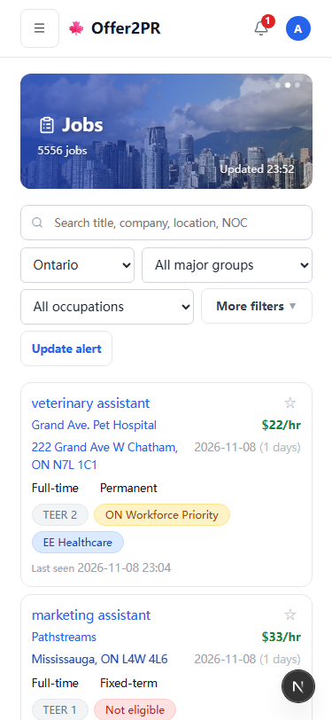 |

## 2. 网页端

### 2.1 方案卡

| 改之前 | 改之后 |
|---|---|
| 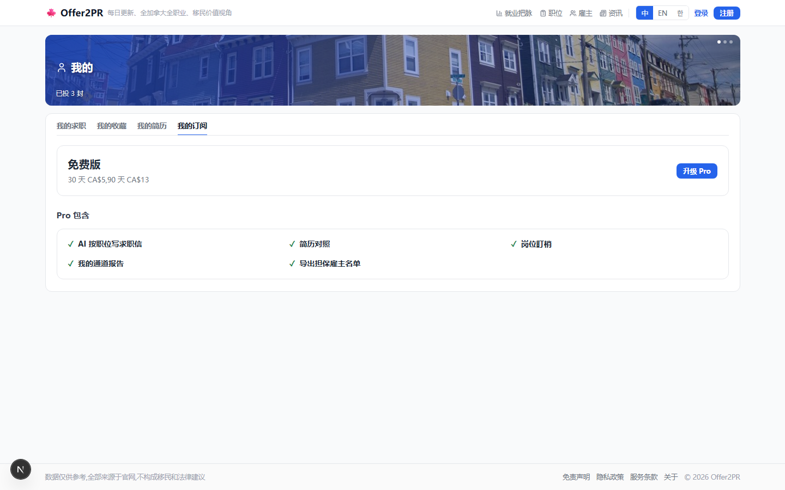 | 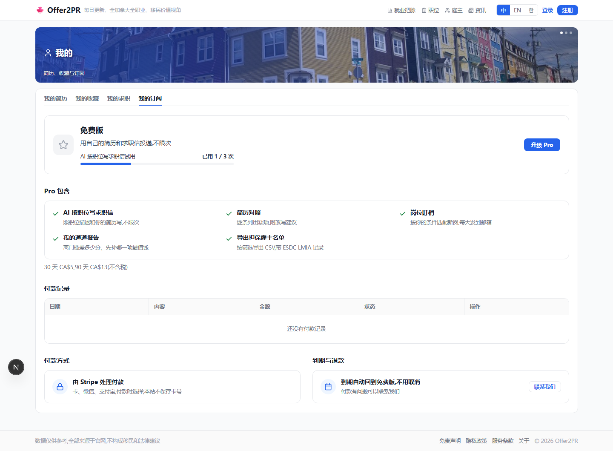 |

### 2.2 提醒列表:按档案推荐加按条件的提醒

| 改之前 | 改之后 |
|---|---|
| 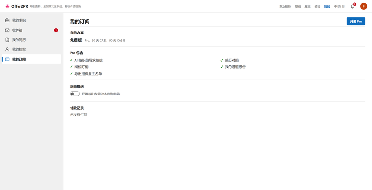 | 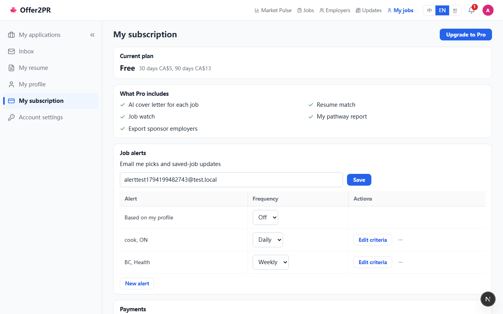 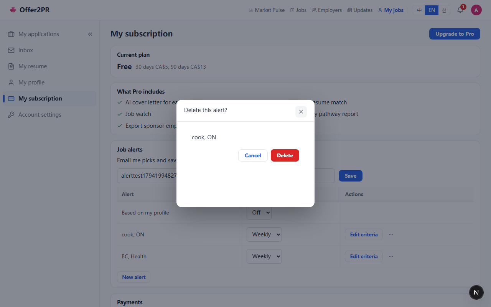 |

### 2.3 职位板创建提醒、改条件

| 改之前 | 改之后 |
|---|---|
|  | 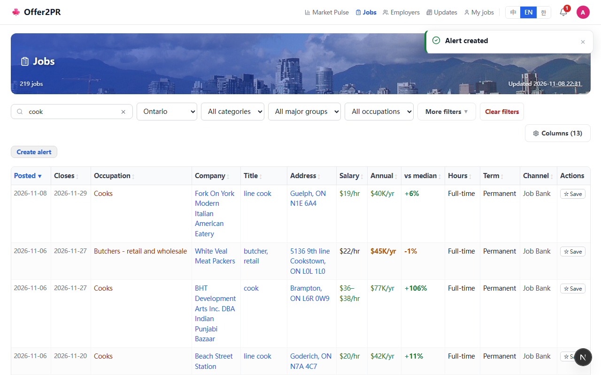 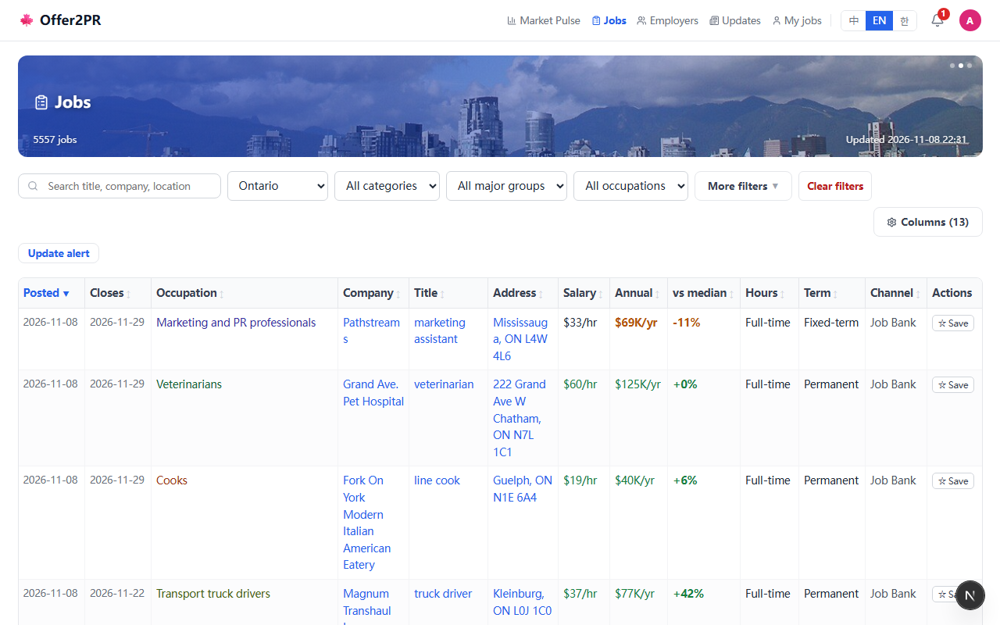 |
