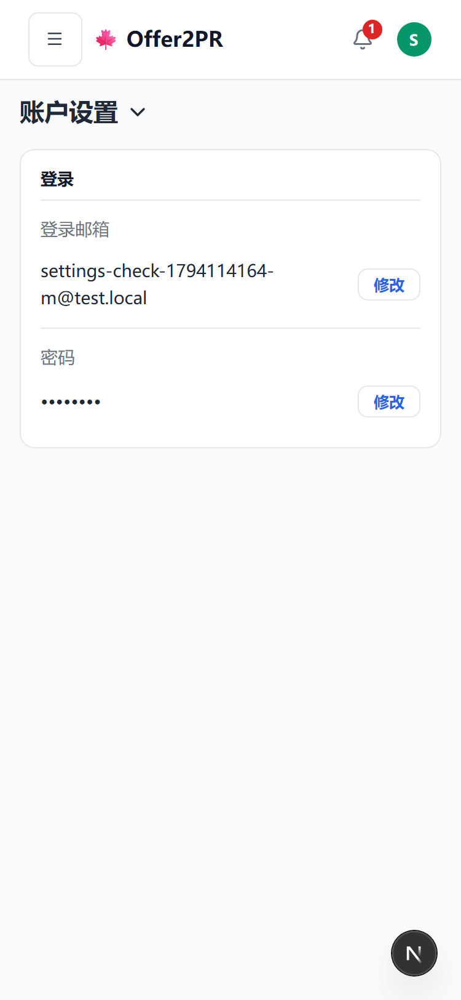
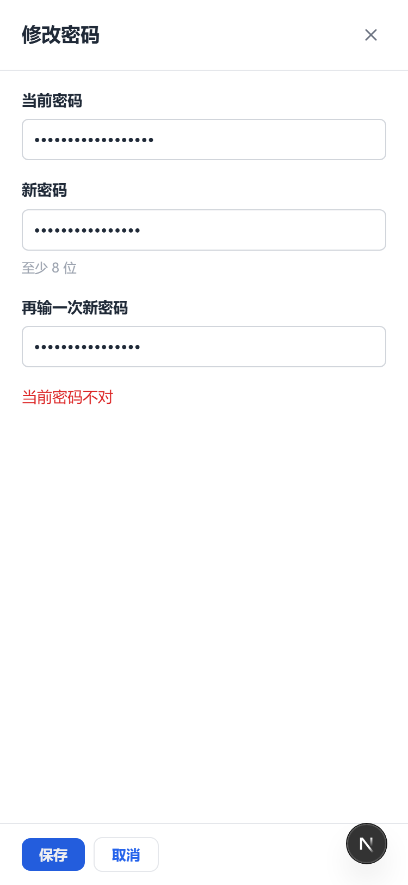
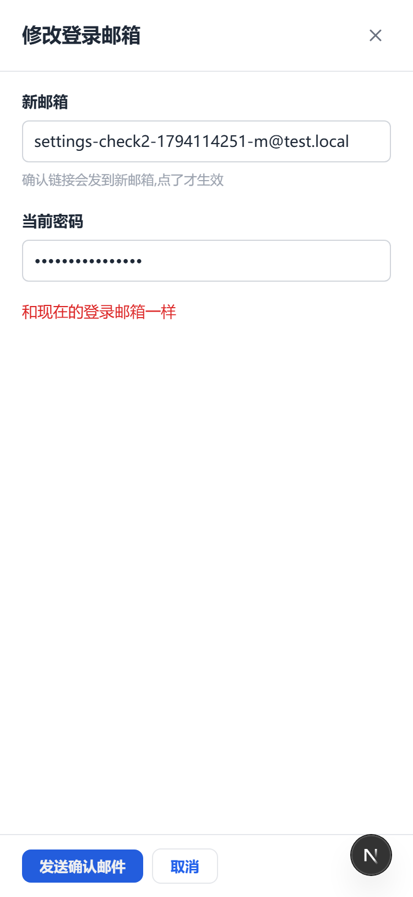
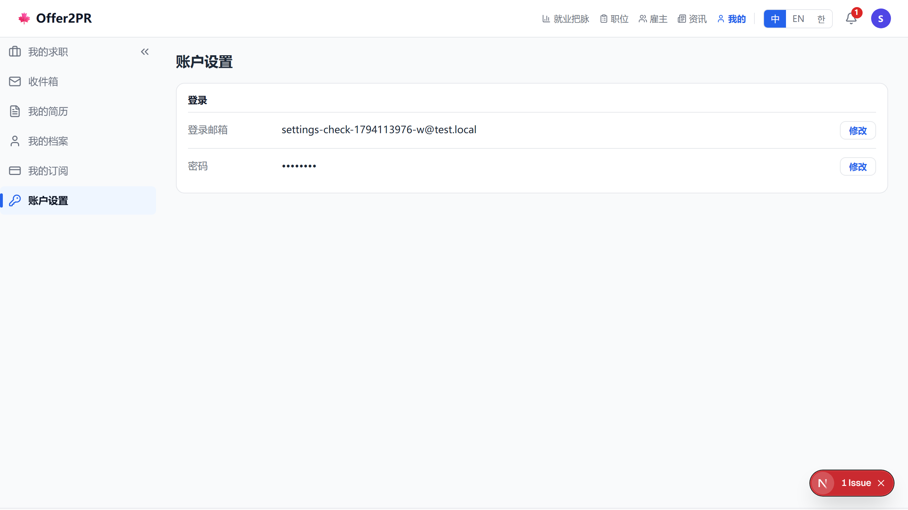
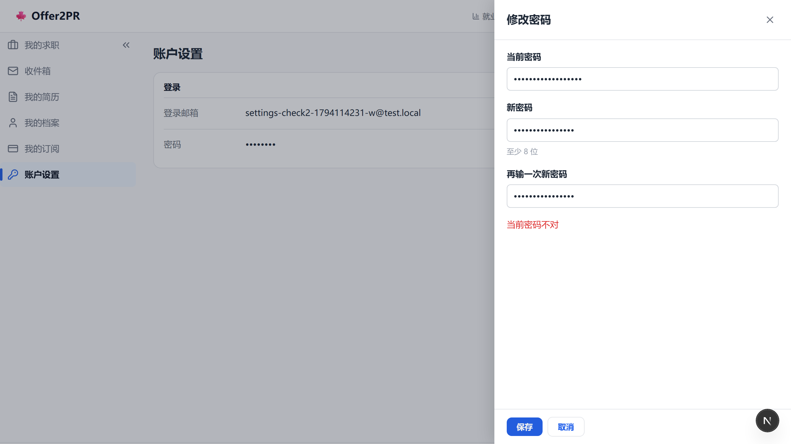
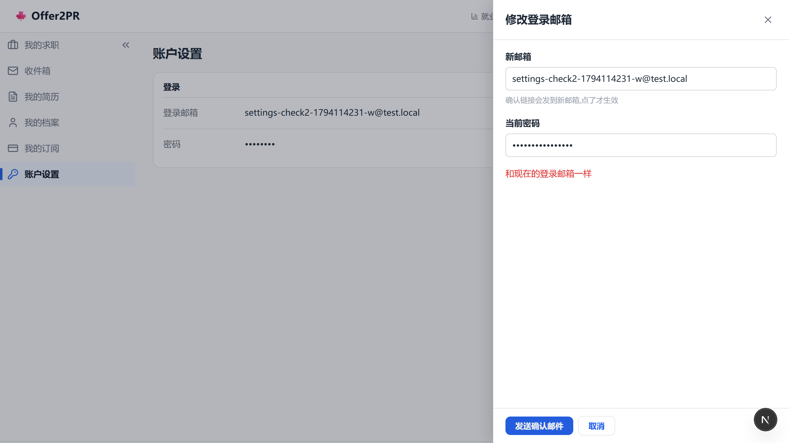

# 账户设置：改登录邮箱、改密码（2026-11-07）

## 1. 手机端

### 1.1 账户设置

| 改之前 | 改之后 |
|---|---|
|  |  |

### 1.2 修改密码

| 改之前 | 改之后 |
|---|---|
|  |  |

### 1.3 修改登录邮箱

| 改之前 | 改之后 |
|---|---|
|  |  |

## 2. 网页端

### 2.1 账户设置

| 改之前 | 改之后 |
|---|---|
|  |  |

### 2.2 修改密码

| 改之前 | 改之后 |
|---|---|
|  |  |

### 2.3 修改登录邮箱

| 改之前 | 改之后 |
|---|---|
|  |  |
