# 抽选页:配额 / 抽选节奏 / 事件流 三段分区卡(2026-10-12)

## 1. 手机端

### 1.1 横幅

| 改之前 | 改之后 |
|---|---|
|  |  |

### 1.2 配额

| 改之前 | 改之后 |
|---|---|
| 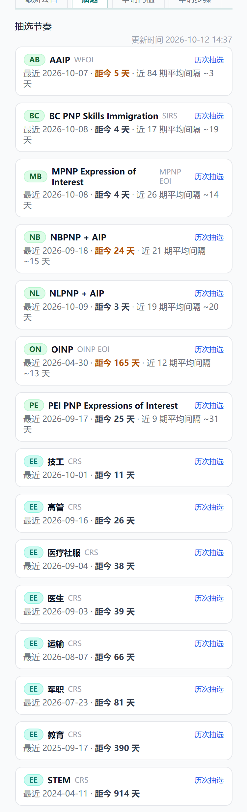 | 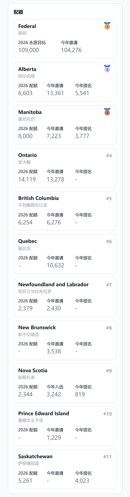 |

### 1.3 抽选节奏

| 改之前 | 改之后 |
|---|---|
|  | 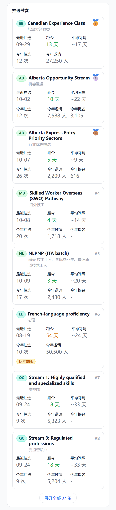 |

### 1.4 事件流

| 改之前 | 改之后 |
|---|---|
| 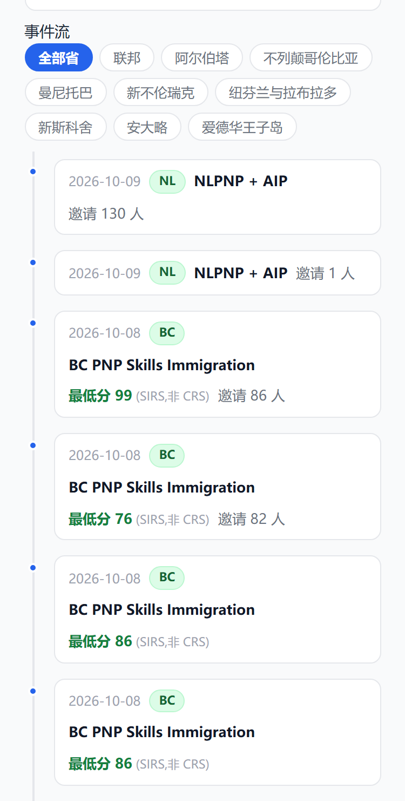 | 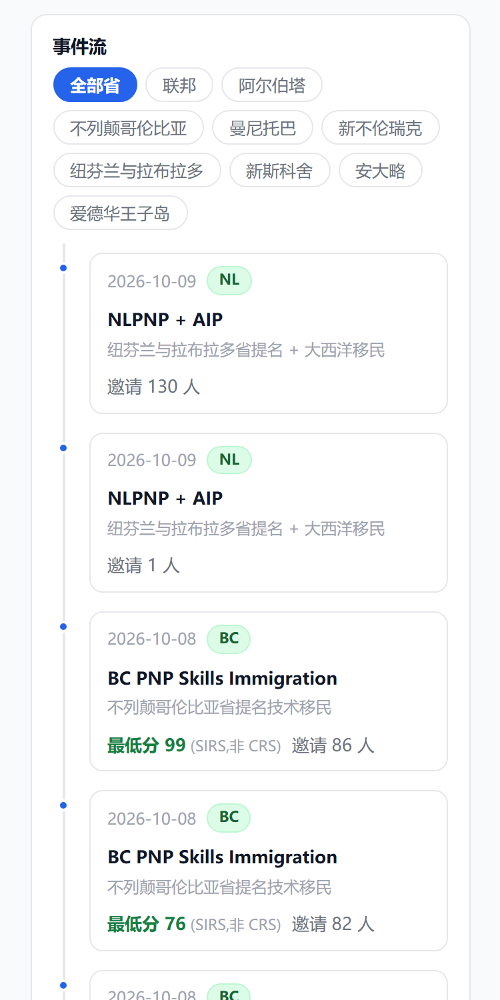 |

### 1.5 点联邦类别

| 改之前 | 改之后 |
|---|---|
|  | 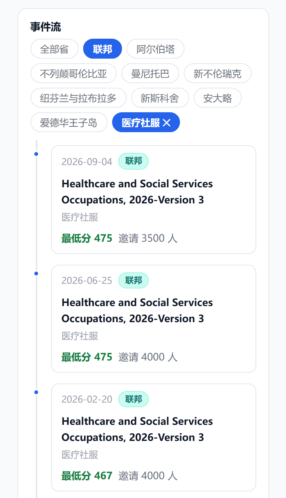 |

## 2. 网页端

### 2.1 横幅

| 改之前 | 改之后 |
|---|---|
|  |  |

### 2.2 配额

| 改之前 | 改之后 |
|---|---|
| 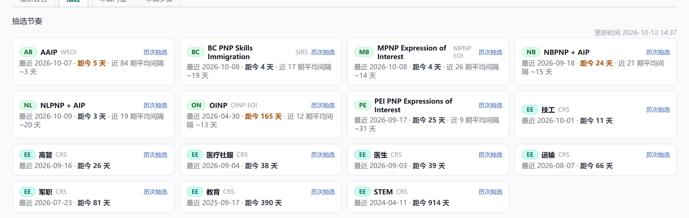 | 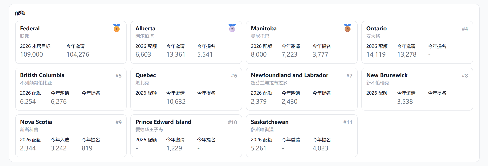 |

### 2.3 抽选节奏

| 改之前 | 改之后 |
|---|---|
|  | 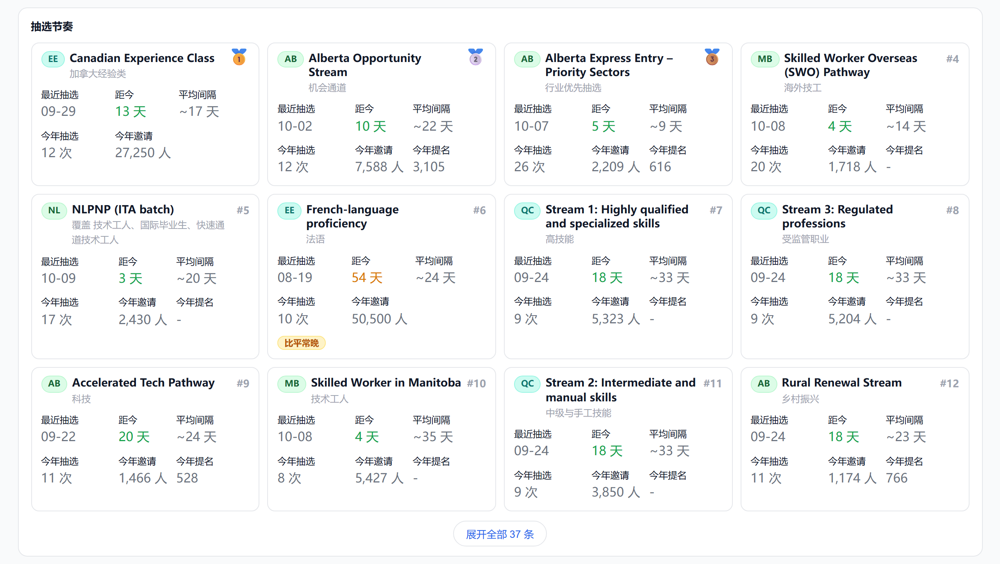 |

### 2.4 事件流

| 改之前 | 改之后 |
|---|---|
| 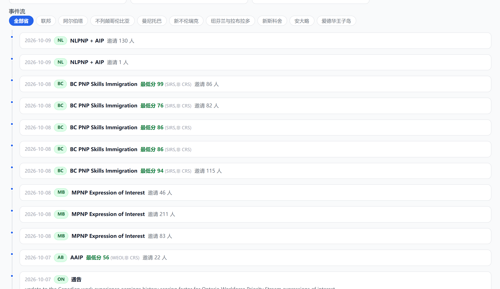 | 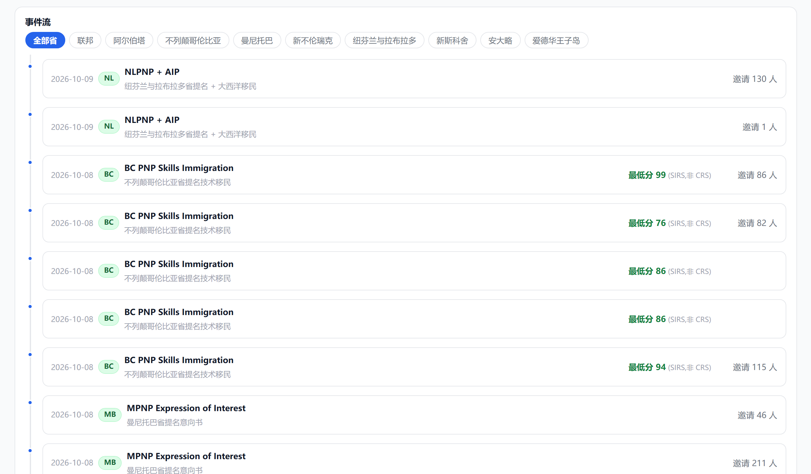 |

### 2.5 点联邦类别

| 改之前 | 改之后 |
|---|---|
|  | 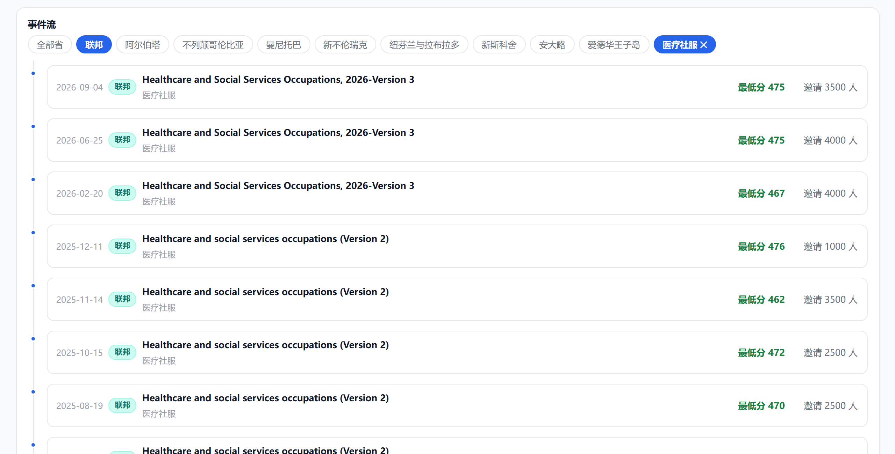 |
