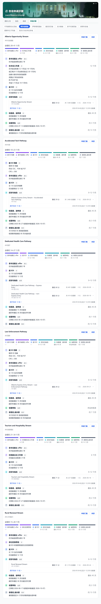
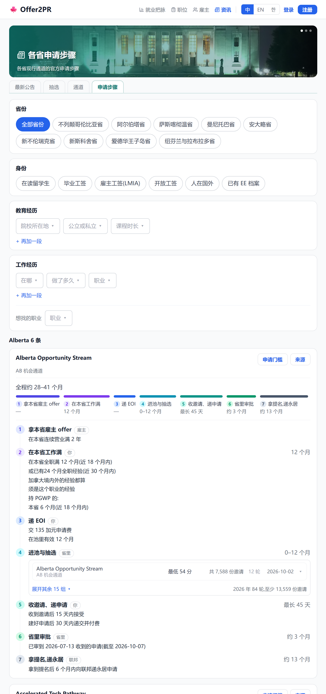
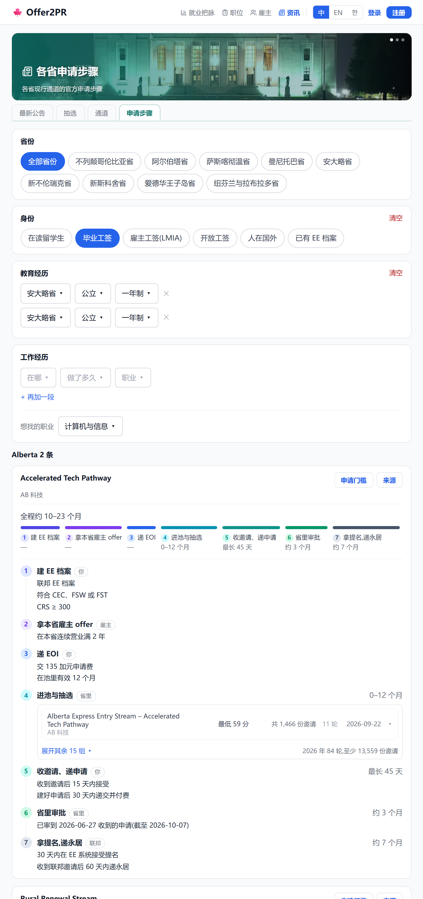
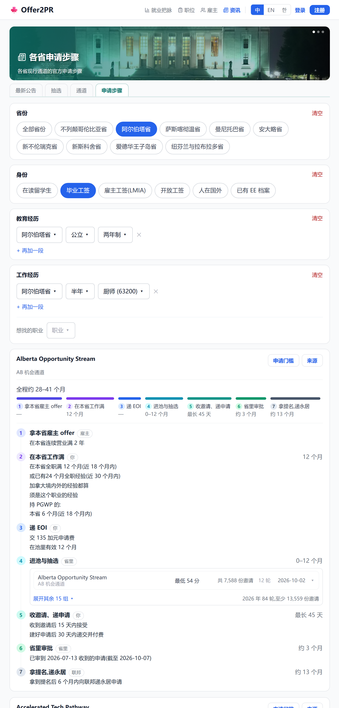

# 申请步骤:分区筛选(2026-10-11)

## 1. 手机端

### 1.1 不选省份,显示全部省的通道

| 改之前 | 改之后 |
|---|---|
|  |  |

### 1.2 不选省份 · 毕业工签 · 安省公立 college 两段一年制(人工智能、云计算)· 计算机岗,各省只剩能走的

| 改之前 | 改之后 |
|---|---|
|  |  |

### 1.3 选阿尔伯塔省 · 毕业工签 · 阿省公立两年制 · 在阿省做厨师半年,剩 5 条

| 改之前 | 改之后 |
|---|---|
|  |  |

## 2. 网页端

### 2.1 不选省份,显示全部省的通道

| 改之前 | 改之后 |
|---|---|
|  |  |

### 2.2 不选省份 · 毕业工签 · 安省公立 college 两段一年制(人工智能、云计算)· 计算机岗,各省只剩能走的

| 改之前 | 改之后 |
|---|---|
|  |  |

### 2.3 选阿尔伯塔省 · 毕业工签 · 阿省公立两年制 · 在阿省做厨师半年,剩 5 条

| 改之前 | 改之后 |
|---|---|
|  |  |
