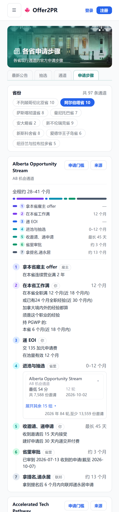
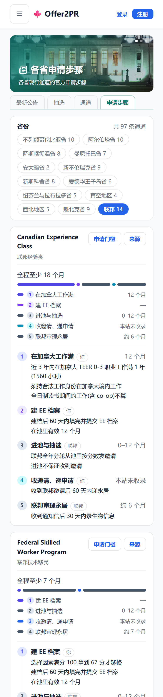
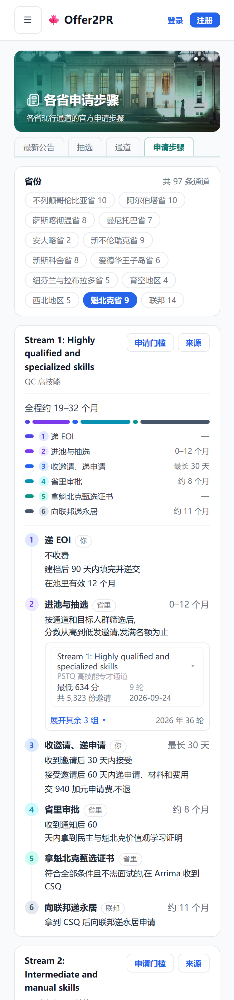
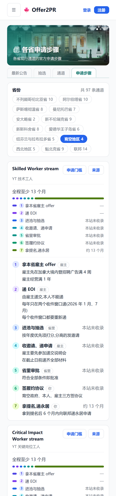
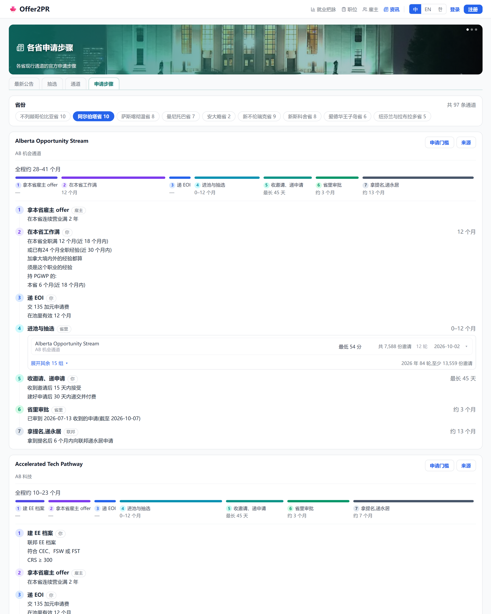
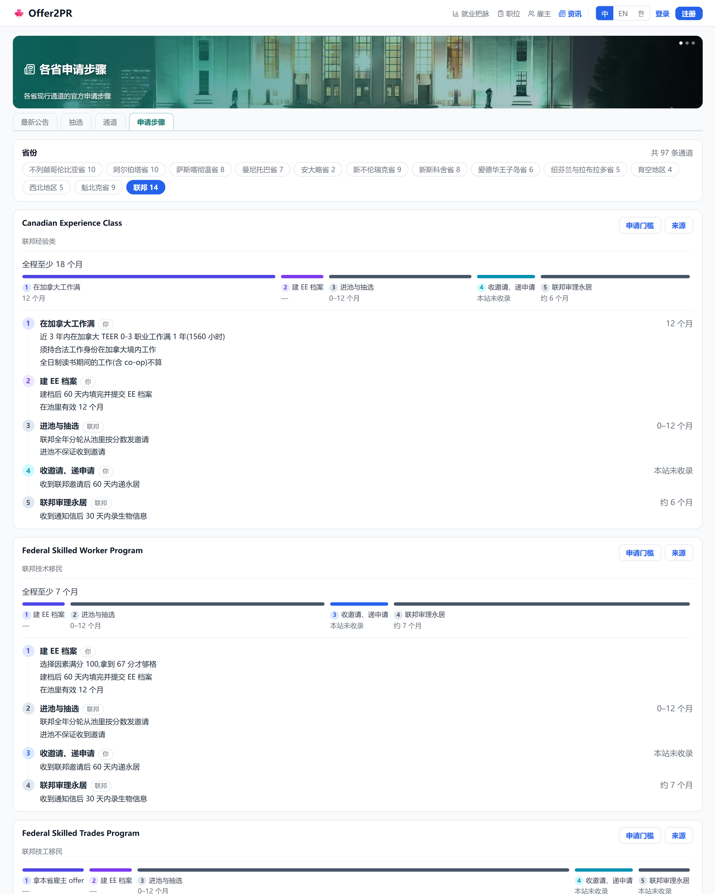
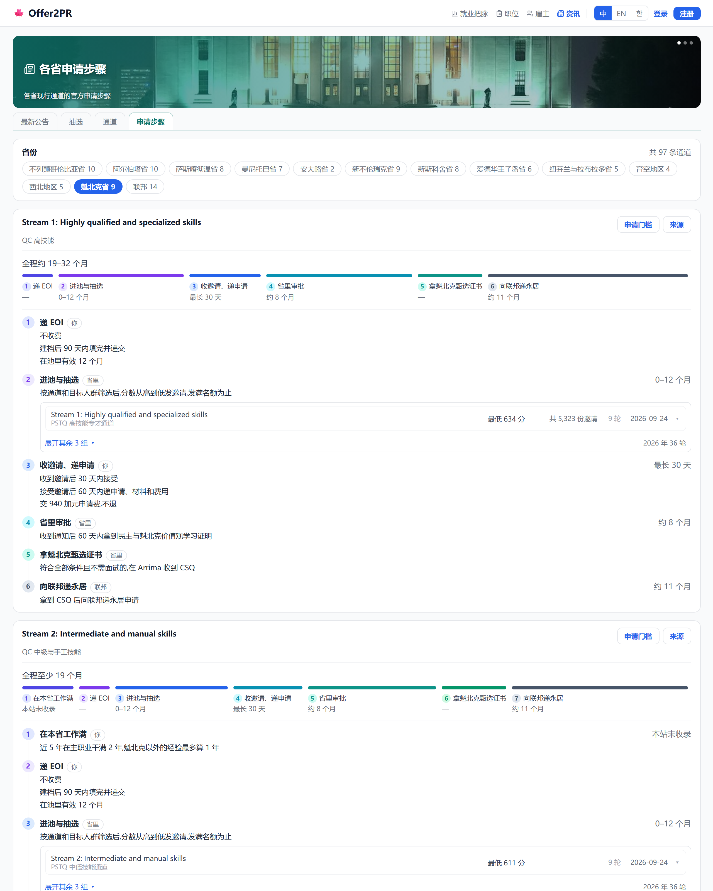
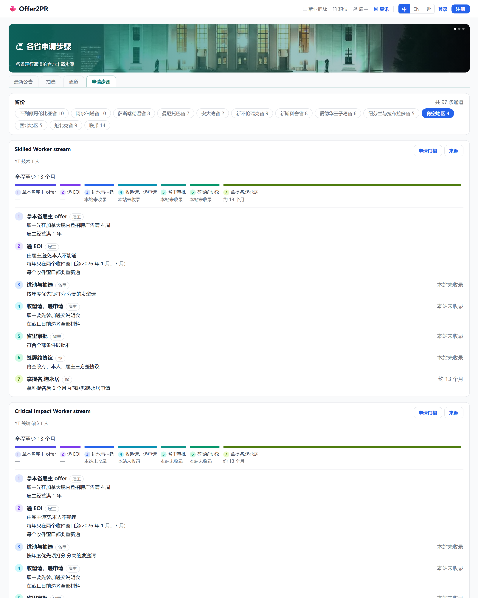

# 申请步骤:加育空 / 西北地区 / 魁北克 / 联邦入口(2026-10-12)

## 1. 手机端

### 1.1 点「联邦」:EE 三类、AIP、RCIP、FCIP、家庭团聚、难民

| 改之前 | 改之后 |
|---|---|
|  |  |

### 1.2 点「魁北克省」:PSTQ 四类、PEQ 两类、商业三类

| 改之前 | 改之后 |
|---|---|
|  |  |

### 1.3 点「育空地区」:三条工人类 + 商业类

| 改之前 | 改之后 |
|---|---|
|  |  |

## 2. 网页端

### 2.1 点「联邦」:EE 三类、AIP、RCIP、FCIP、家庭团聚、难民

| 改之前 | 改之后 |
|---|---|
|  |  |

### 2.2 点「魁北克省」:PSTQ 四类、PEQ 两类、商业三类

| 改之前 | 改之后 |
|---|---|
|  |  |

### 2.3 点「育空地区」:三条工人类 + 商业类

| 改之前 | 改之后 |
|---|---|
|  |  |
