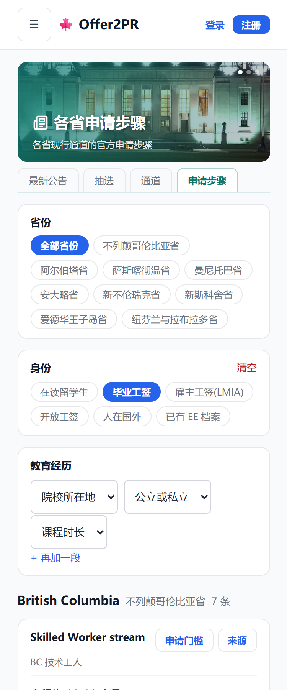
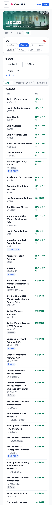
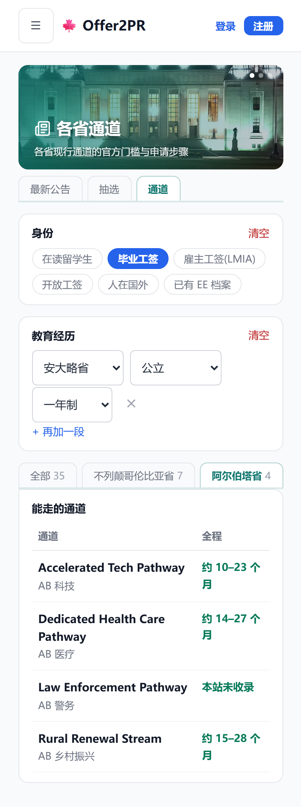
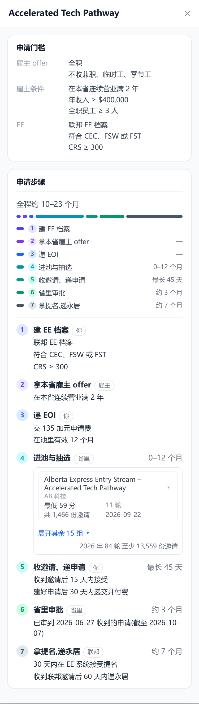
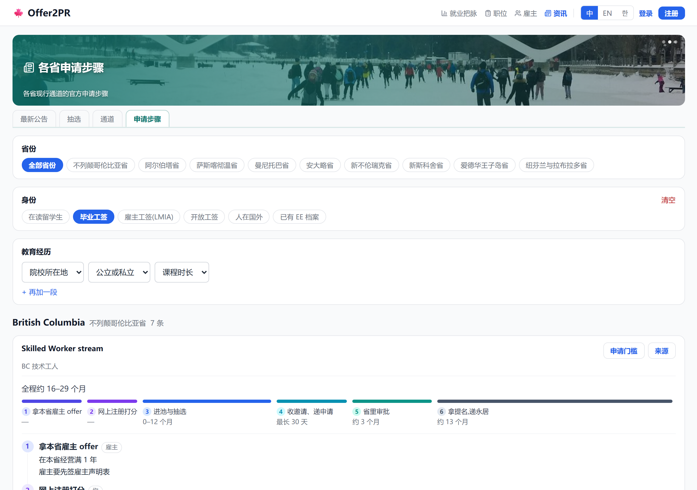
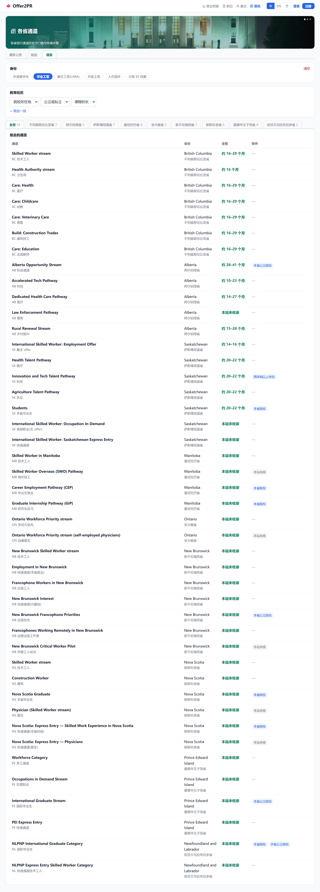
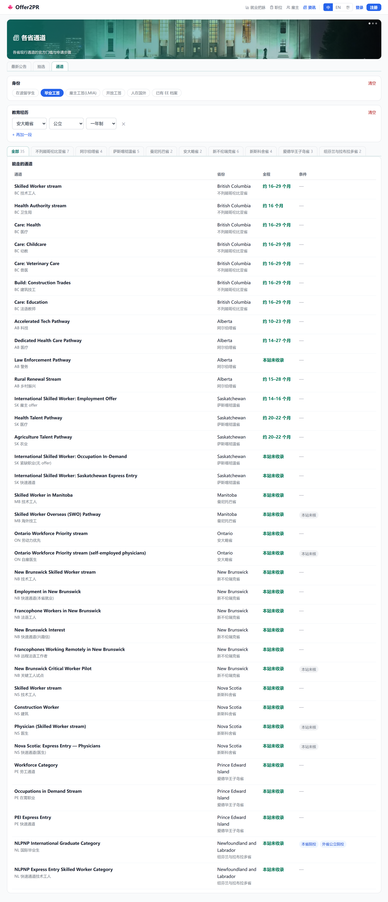
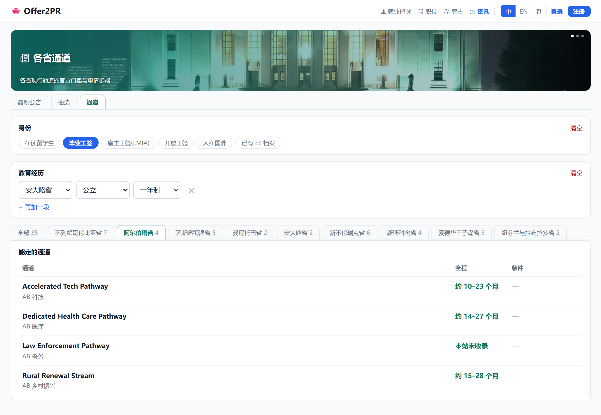
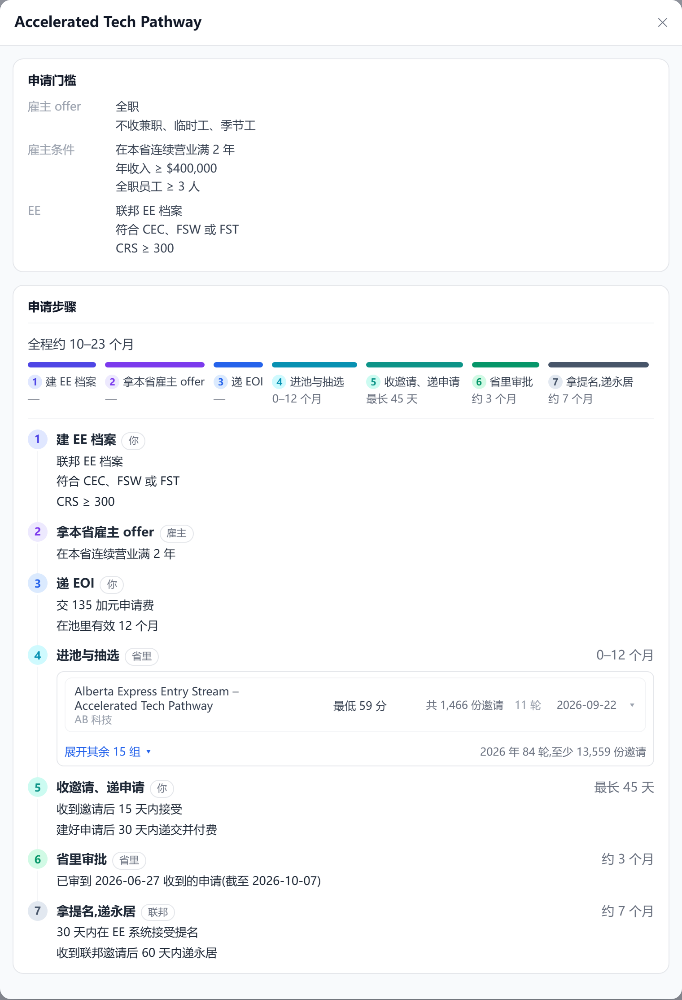

# 通道:合并申请步骤,筛完先出能走的通道表(2026-10-12)

## 1. 手机端

### 1.1 只选「毕业工签」:省份挪到结果卡上方当页签(同二级导航样式),下面先出能走的通道表

| 改之前 | 改之后 |
|---|---|
|  |  |

### 1.2 再填「安大略省 · 公立 · 一年制」:表里只剩能走的

| 改之前 | 改之后 |
|---|---|
|  |  |

### 1.3 点「阿尔伯塔省」页签:只列这一省

| 改之前 | 改之后 |
|---|---|
|  |  |

### 1.4 点一行:弹框里上面申请门槛、下面申请步骤

| 改之前 | 改之后 |
|---|---|
|  |  |

## 2. 网页端

### 2.1 只选「毕业工签」:省份挪到结果卡上方当页签(同二级导航样式),下面先出能走的通道表

| 改之前 | 改之后 |
|---|---|
|  |  |

### 2.2 再填「安大略省 · 公立 · 一年制」:表里只剩能走的

| 改之前 | 改之后 |
|---|---|
|  |  |

### 2.3 点「阿尔伯塔省」页签:只列这一省

| 改之前 | 改之后 |
|---|---|
|  |  |

### 2.4 点一行:弹框里上面申请门槛、下面申请步骤

| 改之前 | 改之后 |
|---|---|
|  |  |
