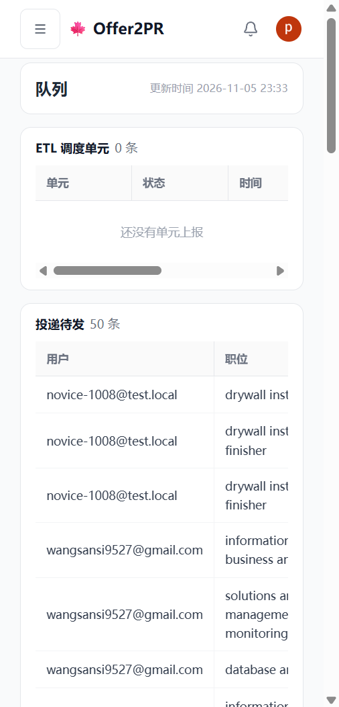
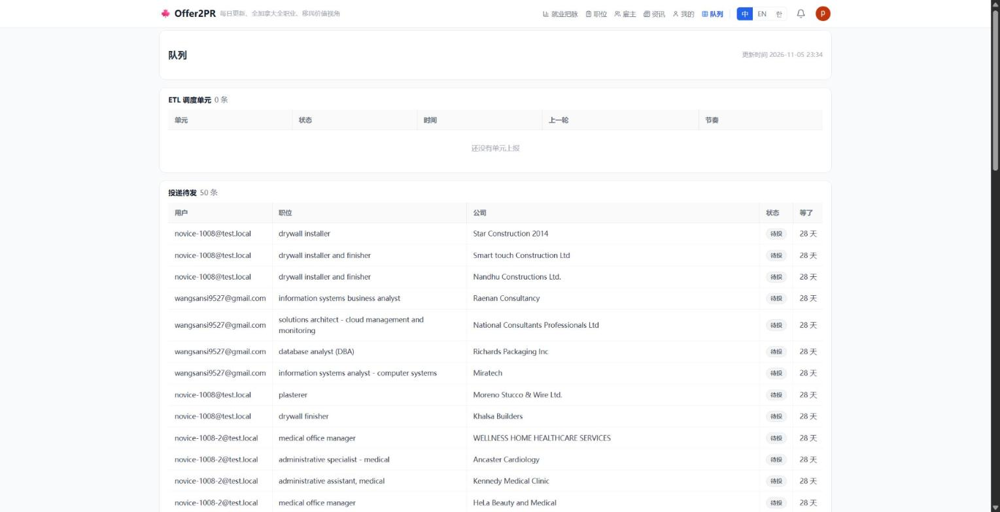

# 管理员队列:顶栏加「队列」,只有管理员看得到(2026-11-05)

## 1. 手机端

### 1.1 抽屉菜单

| 改之前 | 改之后 |
|---|---|
|  |  |

### 1.2 队列页

| 改之前 | 改之后 |
|---|---|
|  |  |

## 2. 网页端

### 2.1 顶栏

| 改之前 | 改之后 |
|---|---|
|  |  |

### 2.2 队列页

| 改之前 | 改之后 |
|---|---|
|  |  |
