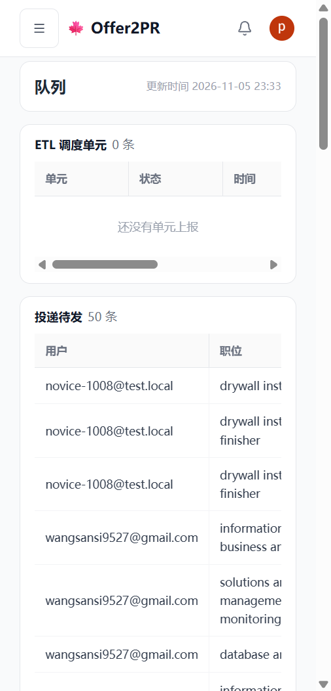
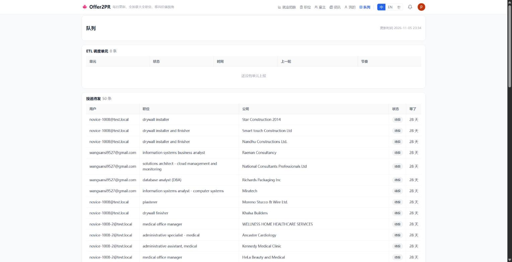

# 运维:管理员「队列」页重构成「运维」页(2026-11-08)

## 1. 手机端

### 1.1 打开导航

| 改之前 | 改之后 |
|---|---|
| — |  |

### 1.2 服务报告

| 改之前 | 改之后 |
|---|---|
|  |  |

### 1.3 事件

| 改之前 | 改之后 |
|---|---|
| — |  |

### 1.4 报警规则

| 改之前 | 改之后 |
|---|---|
| — |  |

### 1.5 调度单元

| 改之前 | 改之后 |
|---|---|
| — |  |

### 1.6 运行历史

| 改之前 | 改之后 |
|---|---|
| — |  |

### 1.7 投递待发

| 改之前 | 改之后 |
|---|---|
| — |  |

### 1.8 官网抓取

| 改之前 | 改之后 |
|---|---|
| — |  |

### 1.9 译名翻译

| 改之前 | 改之后 |
|---|---|
| — |  |

### 1.10 数据新鲜度

| 改之前 | 改之后 |
|---|---|
| — |  |

### 1.11 通道状态

| 改之前 | 改之后 |
|---|---|
| — |  |

### 1.12 功能通道

| 改之前 | 改之后 |
|---|---|
| — |  |

### 1.13 通道实测

| 改之前 | 改之后 |
|---|---|
| — |  |

### 1.14 用量

| 改之前 | 改之后 |
|---|---|
| — |  |

### 1.15 成本

| 改之前 | 改之后 |
|---|---|
| — |  |

### 1.16 额度

| 改之前 | 改之后 |
|---|---|
| — |  |

### 1.17 Workspace 和 Key

| 改之前 | 改之后 |
|---|---|
| — |  |

## 2. 网页端

### 2.1 服务报告

| 改之前 | 改之后 |
|---|---|
|  |  |

### 2.2 事件

| 改之前 | 改之后 |
|---|---|
| — |  |

### 2.3 报警规则

| 改之前 | 改之后 |
|---|---|
| — |  |

### 2.4 调度单元

| 改之前 | 改之后 |
|---|---|
| — |  |

### 2.5 运行历史

| 改之前 | 改之后 |
|---|---|
| — |  |

### 2.6 投递待发

| 改之前 | 改之后 |
|---|---|
| — |  |

### 2.7 官网抓取

| 改之前 | 改之后 |
|---|---|
| — |  |

### 2.8 译名翻译

| 改之前 | 改之后 |
|---|---|
| — |  |

### 2.9 数据新鲜度

| 改之前 | 改之后 |
|---|---|
| — |  |

### 2.10 通道状态

| 改之前 | 改之后 |
|---|---|
| — |  |

### 2.11 功能通道

| 改之前 | 改之后 |
|---|---|
| — |  |

### 2.12 通道实测

| 改之前 | 改之后 |
|---|---|
| — |  |

### 2.13 用量

| 改之前 | 改之后 |
|---|---|
| — |  |

### 2.14 成本

| 改之前 | 改之后 |
|---|---|
| — |  |

### 2.15 额度

| 改之前 | 改之后 |
|---|---|
| — |  |

### 2.16 Workspace 和 Key

| 改之前 | 改之后 |
|---|---|
| — |  |
